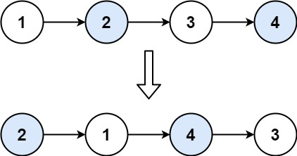

# 24. Swap Nodes in Pairs

Given a linked list, swap every two adjacent nodes and return its head. You must solve the problem without modifying the values in the list's nodes (i.e., only nodes themselves may be changed.)

**hc note:** hc encodes the returned list as its node values. Node identity and whether values were modified are not inspected; the reference solutions swap the nodes by changing links.

**Example 1:**

**Input:** head = \[1,2,3,4]

**Output:** \[2,1,4,3]

**Explanation:**

**Example 2:**

**Input:** head = \[]

**Output:** \[]

**Example 3:**

**Input:** head = \[1]

**Output:** \[1]

**Example 4:**

**Input:** head = \[1,2,3]

**Output:** \[2,1,3]

**Constraints:**

- The number of nodes in the list is in the range `[0, 100]`.
- `0 <= Node.val <= 100`
