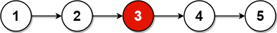
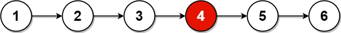

# 876. Middle of the Linked List

Given the `head` of a singly linked list, return *the middle node of the linked list*.

If there are two middle nodes, return **the second middle** node.

**hc note:** Return the node itself. hc displays its zero-based index in the original list.

**Example 1:**



```
Input: head = [1,2,3,4,5]
Output: 2
Explanation: The middle node of the list is node 3.
```

**Example 2:**



```
Input: head = [1,2,3,4,5,6]
Output: 3
Explanation: Since the list has two middle nodes with values 3 and 4, we return the second one.
```

**Constraints:**

- The number of nodes in the list is in the range `[1, 100]`.
- `1 <= Node.val <= 100`
