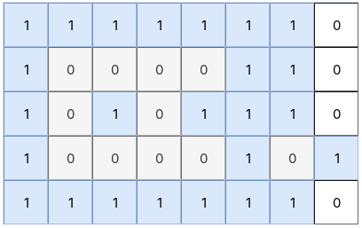
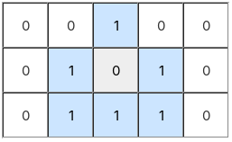

# 1254. 统计封闭岛屿的数目

给定一个由 `0`（陆地）和 `1`（水域）组成的二维网格 `grid`。一个岛屿是由 `0` 组成的、在上下左右四个方向上连通的极大区域，而一个封闭岛屿是指一个被 `1` 从四周（左、上、右、下）**完全** 包围的岛屿。

返回封闭岛屿的数量。

**示例 1：**

**输入：** grid = \[\[1,1,1,1,1,1,1,0],\[1,0,0,0,0,1,1,0],\[1,0,1,0,1,1,1,0],\[1,0,0,0,0,1,0,1],\[1,1,1,1,1,1,1,0]]

**输出：** 2

**解释：**

- 网格中包含四个由 0 组成的岛屿。
- 横跨第 1 行至第 3 行、第 1 列至第 4 列的岛屿被 1 完全包围。它还包围了位于第 2 行、第 2 列的水域单元格。因此，它是一个封闭岛屿。
- 位于第 3 行、第 6 列的单个 0 在上下左右四个方向上都被 1 包围，因此它也是一个封闭岛屿。
- 剩余的两个岛屿都位于第 7 列，该列处于网格边界上，因此它们都不是封闭岛屿。
- 共有两个封闭岛屿，在图中以灰色表示，因此答案为 2。

**示例 2：**

**输入：** grid = \[\[0,0,1,0,0],\[0,1,0,1,0],\[0,1,1,1,0]]

**输出：** 1

**解释：**

- 网格中包含三个由 0 组成的岛屿。
- 位于第 1 行、第 2 列的单个 0，其上方、下方、左侧和右侧都是 1，因此它是一个封闭岛屿，在图中以灰色表示。
- 由第 0 列的第 0 行至第 2 行，以及第 0 行、第 1 列组成的岛屿位于网格边界上，因此不是封闭岛屿。
- 由第 4 列的第 0 行至第 2 行，以及第 0 行、第 3 列组成的岛屿同样位于网格边界上，因此不是封闭岛屿。
- 共有一个封闭岛屿，因此答案为 1。

**示例 3：**

**输入：** grid = \[\[1,1,1,1,1,1,1],\[1,0,0,0,0,0,1],\[1,0,1,1,1,0,1],\[1,0,1,0,1,0,1],\[1,0,1,1,1,0,1],\[1,0,0,0,0,0,1],\[1,1,1,1,1,1,1]]

**输出：** 2

**解释：**

- 网格中包含两个由 0 组成的岛屿，其中一个位于另一个的内部。
- 外层岛屿是由第 1 行至第 5 行、第 1 列至第 5 列的 0 组成的环形区域。它被外围一圈 1 包围，因此是一个封闭岛屿。
- 内层岛屿是位于第 3 行、第 3 列的单个 0。它被内层一圈 1 包围，因此也是一个封闭岛屿。
- 两个岛屿都是封闭岛屿，因此答案为 2。

**提示：**

- `1 <= grid.length, grid[0].length <= 100`
- `0 <= grid[i][j] <= 1`
